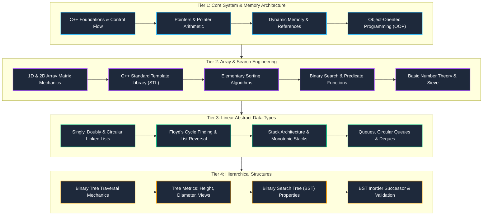
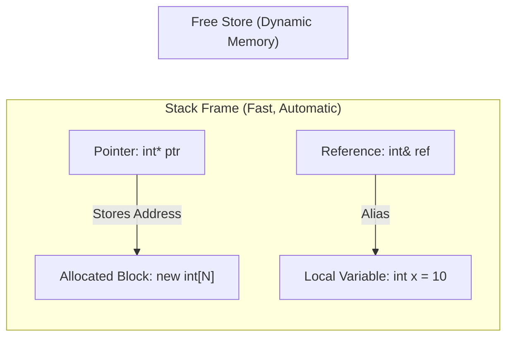
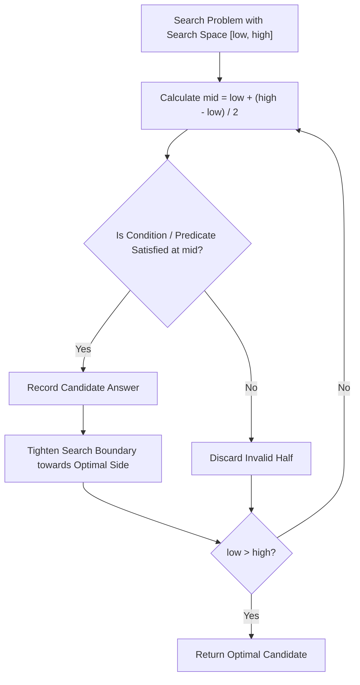
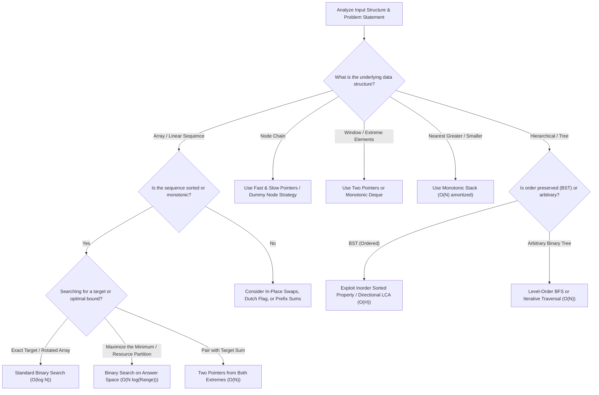

# ⚡ Algorithmic Engineering & C++ Problem Solving

### Targeted Technical Interview Mastery · Based on Love Babbar CodeHelp 149 Series

<p align="center">
  <a href="https://youtube.com/playlist?list=PLDzeHZWIZsTryvtXdMr6rPh4IDexB5NIA&si=aquEb5Btofp6vk0z">
    
  </a>
  
  
  
</p>

---

## 🧭 Executive Overview

This repository houses a **curated, high-impact implementation framework** derived from Love Babbar’s flagship CodeHelp 149 series. 

Rather than attempting an unfocused survey, this workspace deliberately targets the **core engineering foundations of computer science**: systems-level C++ mechanics, pointer and dynamic memory architecture, array engineering, search-space reduction, sorting paradigms, linear abstract data types, and hierarchical tree structures.

> **Core Engineering Philosophy:**
> 
> $$\text{Understand Invariants} \longrightarrow \text{Design Optimal State} \longrightarrow \text{Implement with Zero Overhead} \longrightarrow \text{Verify Edge Cases}$$

---

## ⚡ Quick Navigation

| Section | Description |
| :--- | :--- |
| [🗺️ Architectural Blueprint](#️-architectural-blueprint) | Visual end-to-end curriculum pipeline |
| [📐 Core Engineering Modules](#-core-engineering-modules) | Interactive deep dives into language, memory, algorithms & structures |
| [🧠 Algorithm Selection Engine](#-algorithm-selection-engine) | Decision framework for competitive and interview problem solving |
| [📊 Complexity & Performance Matrix](#-complexity--performance-matrix) | Space-time asymptotics reference for in-scope structures |
| [📂 Repository Topology](#-repository-topology) | Directory and file mapping across the workspace |
| [🎯 Interview Engineering Protocol](#-interview-engineering-protocol) | Systematic process for solving problems under interview conditions |

---

## 🗺️ Architectural Blueprint

The curriculum is structured into five progressive tiers, transitioning from low-level memory mechanics up to hierarchical data architectures:



---

## 📐 Core Engineering Modules

Click on any module below to expand its technical breakdown, mental models, key problem archetypes, and implementation traps.

<details open>
<summary><b>🔹 Module 01: Systems-Level C++, Memory Model & OOP</b></summary>

<br>

Mastering the low-level execution environment of C++ is fundamental to writing performant algorithms.



#### Core Competencies:
- **Pointers & Arithmetic:** Single, double (`int**`), and multi-level indirection; array decayed pointers; constant pointers vs. pointers to constants.
- **Dynamic Memory Management:** Stack vs. Free Store allocation via `new` / `delete`; preventing memory leaks and dangling pointer hazards.
- **Reference Semantics:** Pass-by-value vs. Pass-by-reference (`&`); const reference optimizations for large objects.
- **Object-Oriented Programming (OOPs):**
  - **Encapsulation:** Data hiding, access specifiers (`private`, `protected`, `public`).
  - **Abstraction:** Interface design and implementation decoupling.
  - **Inheritance:** Single, multi-level, multiple, hierarchical, and hybrid inheritance patterns.
  - **Polymorphism:** Compile-time (function/operator overloading) vs. Run-time (virtual functions, vtable, vptr).

> [!TIP]
> Always pair dynamic allocations (`new[]`) with an explicit deallocation (`delete[]`) in procedural C++, or encapsulate them within RAII containers.

</details>

<br>

<details>
<summary><b>🔹 Module 02: Array Engineering, String Processing & Mathematical DSA</b></summary>

<br>

Arrays form the memory layout foundation of modern CPUs due to contiguous memory allocation and spatial cache locality.

#### Core Competencies:
- **Multi-Dimensional Arrays:** Row-major memory layout, 2D matrix traversal patterns (Wave Print, Spiral Matrix traversal, Matrix Transpose, In-place 90° rotation).
- **Two-Pointer & Sliding Window Techniques:** Extreme-end two pointers for sorted arrays, Dutch National Flag algorithm (`Sort 0, 1, 2`), partition mechanics.
- **Character Arrays & Strings:** In-place string reversal, palindrome validation, custom tokenizer logic, character frequency tracking, and string compression.
- **Mathematical DSA & Number Theory:**
  - **Sieve of Eratosthenes:** Prime generation in $O(N \log \log N)$ time.
  - **Euclidean Algorithm:** Computing Greatest Common Divisor ($\gcd(a, b)$) in logarithmic time.
  - **Modular Arithmetic:** Fast modular exponentiation $a^b \pmod m$ in $O(\log b)$ time to prevent integer overflow.
- **Standard Template Library (STL):** Deep internal mechanics of `std::vector`, `std::deque`, `std::list`, `std::pair`, `std::stack`, and `std::queue`.

> [!IMPORTANT]
> When performing modular arithmetic on multiplication, always cast intermediate products to `long long` prior to modulo application to prevent signed 32-bit overflow.

</details>

<br>

<details>
<summary><b>🔹 Module 03: Search Space Reduction & Sorting Paradigms</b></summary>

<br>

Binary Search is not merely an array search algorithm; it is a general mathematical framework for searching across any monotonic decision space.



#### Core Competencies:
- **Search Space Monotonicity:** Identifying invariant monotonic conditions $f(\text{mid}) \in \{0, 1\}$.
- **Standard Binary Search Variants:** First and last occurrence of an element, peak index in mountain array, search in rotated sorted array, square root computation.
- **Binary Search on Answer (Advanced Predicates):**
  - **Book Allocation Problem:** Minimizing the maximum pages allocated.
  - **Aggressive Cows Problem:** Maximizing the minimum distance between placements.
  - **Painter's Partition Problem:** Work distribution over parallel monotonic workers.
- **Elementary Sorting Algorithms:**
  - **Selection Sort:** Selecting the minimum element in the unsorted suffix ($O(N^2)$, unstable).
  - **Bubble Sort:** Adjacent element swap with early termination optimization ($O(N)$ best case).
  - **Insertion Sort:** Shifting sorted prefix elements to insert target in correct place ($O(N)$ best case, stable, ideal for nearly-sorted data).

> [!NOTE]
> Standard formula `(start + end) / 2` triggers integer overflow for large indices ($> 2^{31} - 1$). Always formulate as `start + (end - start) / 2`.

</details>

<br>

<details>
<summary><b>🔹 Module 04: Linear Abstract Data Types (Linked Lists, Stacks & Queues)</b></summary>

<br>

Linear structures balance dynamic node-based flexibility against constant-time access guarantees.

#### Core Competencies:
- **Linked List Architectures:**
  - **Singly Linked List:** Node dynamic chaining, pointer updates, head/tail boundary handling.
  - **Doubly Linked List:** Bidirectional node linkage, edge-node insertion and deletion.
  - **Circular Linked List:** Cycle maintenance without a null termination pointer.
  - **Core List Algorithms:** In-place linked list reversal (iterative three-pointer approach: `prev`, `curr`, `forward`), middle element location (slow/fast pointers), Floyd's Cycle Detection Algorithm (cycle identification and cycle start node location), duplicate removal, merging sorted lists.
- **Stack Abstract Data Type (LIFO):**
  - Array-based and dynamic pointer implementations.
  - Two stacks sharing a single contiguous array buffer.
  - Parentheses validation and balanced expression parsing.
  - **Monotonic Stacks:** Computing Next Greater Element (NGE), Next Smaller Element (NSE), and Largest Rectangle in Histogram.
- **Queue & Deque Abstract Data Types (FIFO):**
  - Circular Queue implementation utilizing circular modular indexing `(rear + 1) % capacity`.
  - Double-Ended Queue (`std::deque` mechanics).
  - First negative integer in every window of size $K$.
  - Interleaving the first and second halves of a queue using auxiliary structures.

> [!TIP]
> In Linked List problems involving head manipulation or edge node deletion, introducing a **Dummy Node** (`ListNode dummy(0); dummy.next = head;`) eliminates null-pointer edge cases.

</details>

<br>

<details>
<summary><b>🔹 Module 05: Hierarchical Structures (Binary Trees & BSTs)</b></summary>

<br>

Hierarchical structures model non-linear parent-child relationships and provide optimal logarithmic operational profiles.

#### Core Competencies:
- **Binary Tree Architecture:**
  - Node definition (`data`, `left*`, `right*`).
  - **Tree Traversals:** Depth-First Search (Pre-order, In-order, Post-order) and Breadth-First Search (Level-Order Traversal using Queue).
  - **Morris Traversal:** In-order traversal achieving $O(1)$ auxiliary space utilizing threaded tree properties without call stacks.
  - **Tree Metrics:** Calculation of Height / Depth, Tree Diameter ($O(N)$ single-pass bottom-up computation), Balanced Tree validation.
  - **Tree Views & Projections:** Top View, Bottom View, Left View, Right View via vertical coordinate mapping and level queues.
- **Binary Search Tree (BST) Architecture:**
  - Fundamental BST Property: $\forall x \in \text{Left}(root), \text{val}(x) < \text{val}(root)$ and $\forall y \in \text{Right}(root), \text{val}(y) > \text{val}(root)$.
  - In-order traversal of a BST produces a strictly increasing sorted sequence.
  - Target search, insertion, and three-case node deletion (zero, one, or two children using inorder predecessor/successor).
  - Minimum/Maximum element location.
  - Lowest Common Ancestor (LCA) in BST utilizing split-value directional routing.
  - Validation of a valid BST within valid value bounds $(\text{minVal}, \text{maxVal})$.

</details>

---

## 🧠 Algorithm Selection Engine

Use this systematic decision framework to select the optimal algorithmic approach based on problem constraints:



---

## 📊 Complexity & Performance Matrix

Comprehensive reference for time and space complexities across all in-scope data structures and operations:

| Data Structure | Access | Search | Insertion | Deletion | Space Complexity | Primary Use Case |
| :--- | :---: | :---: | :---: | :---: | :---: | :--- |
| **Array / Vector** | $O(1)$ | $O(N)$ / $O(\log N)^*$ | $O(1)$ am. at end / $O(N)$ | $O(1)$ at end / $O(N)$ | $O(N)$ | Contiguous storage, cache-friendly iteration |
| **Singly Linked List** | $O(N)$ | $O(N)$ | $O(1)$ at head / $O(N)$ | $O(1)$ at head / $O(N)$ | $O(N)$ | Dynamic sizing, constant-time head insertion |
| **Doubly Linked List** | $O(N)$ | $O(N)$ | $O(1)$ with pointer | $O(1)$ with pointer | $O(N)$ | Bidirectional navigation, LRU-style manipulation |
| **Stack (LIFO)** | $O(N)$ | $O(N)$ | $O(1)$ push | $O(1)$ pop | $O(N)$ | Expression parsing, Monotonic sequences |
| **Queue / Deque (FIFO)** | $O(N)$ | $O(N)$ | $O(1)$ push | $O(1)$ pop | $O(N)$ | Level-order BFS, sliding window tracking |
| **Binary Tree** | $O(N)$ | $O(N)$ | $O(1)$ at node / $O(N)$ | $O(N)$ | $O(N)$ | Hierarchical data modeling, expression trees |
| **Binary Search Tree (Balanced)** | $O(\log N)$ | $O(\log N)$ | $O(\log N)$ | $O(\log N)$ | $O(N)$ | Dynamic ordered set, range queries |
| **Binary Search Tree (Skewed)** | $O(N)$ | $O(N)$ | $O(N)$ | $O(N)$ | $O(N)$ | Degenerate worst-case scenario (Linked List behavior) |

$^*$ *Search complexity in arrays drops to $O(\log N)$ when the array is sorted using Binary Search.*

---

## 🎯 Interview Engineering Protocol

Every implementation in this repository adheres to this structured four-stage execution lifecycle:

<details open>
<summary><b>1. Constraint Sizing & Asymptotic Budgeting</b></summary>

<br>

Before writing code, calculate the allowable asymptotic complexity directly from input bounds:

| Input Size ($N$) | Required Time Complexity | Typical Strategy |
| :---: | :---: | :--- |
| $N \le 10^2$ | $O(N^3)$ or $O(N^2)$ | Multi-loop traversal, exhaustive matrix scanning |
| $N \le 10^4$ | $O(N^2)$ | Nested pair iteration, elementary sorting |
| $N \le 10^5$ | $O(N \log N)$ or $O(N)$ | Binary Search on Answer, Sorting, Monotonic Stack |
| $N \le 10^6$ | $O(N)$ or $O(N \log N)$ | Linear scan, Two Pointers, Sliding Window |
| $N \ge 10^9$ | $O(\log N)$ or $O(1)$ | Pure Binary Search, Euclidean GCD, Math formulation |

</details>

<br>

<details>
<summary><b>2. Edge Case Diagnostics Matrix</b></summary>

<br>

Verify solutions against these universal failure modes prior to completion:
- **Container Extremes:** Empty collection ($N = 0$), single-element collection ($N = 1$), two-element inversion.
- **Pointer Boundaries:** Deleting the head node, deleting the tail node, cycle starting at the head node.
- **Search Space Limits:** Target smaller than `arr[0]`, target greater than `arr[N - 1]`, target absent from array.
- **Arithmetic Overflow:** Integer addition overflow during midpoint calculation (`start + (end - start) / 2`).
- **Memory Invariants:** Every dynamically allocated dynamic address (`new`) matched with an explicit deallocation (`delete`).

</details>

<br>

<details>
<summary><b>3. Modern C++ Production Template</b></summary>

<br>

Standard boilerplate for competitive coding and technical interviews:

```cpp
#include <iostream>
#include <vector>
#include <string>
#include <algorithm>

using namespace std;

// Fast I/O optimization for high-throughput input
static const auto fast_io = []() {
    ios_base::sync_with_stdio(false);
    cin.tie(nullptr);
    return nullptr;
}();

class Solution {
public:
    int solve(vector<int>& nums) {
        // 1. Edge case handling
        if (nums.empty()) return 0;
        if (nums.size() == 1) return nums[0];

        // 2. Core invariant logic
        int result = 0;
        int left = 0, right = static_cast<int>(nums.size()) - 1;

        while (left <= right) {
            // Safe midpoint calculation
            int mid = left + (right - left) / 2;
            
            // Branch decision logic
            if (nums[mid] >= 0) {
                result = mid;
                left = mid + 1; // Search right half
            } else {
                right = mid - 1; // Search left half
            }
        }

        return result;
    }
};

int main() {
    Solution solver;
    vector<int> sample = {1, 3, 5, 7, 9};
    cout << "Optimal Index: " << solver.solve(sample) << "\n";
    return 0;
}
```

</details>

---

## 📌 Getting Started & Local Setup

### 1. Clone the Workspace
```bash
git clone https://github.com/prashant-sagar-shakya/CodeHelp-Interview-Prep.git
cd CodeHelp-Interview-Prep
```

### 2. Compilation Guidelines
Compile any problem implementation using modern C++20 standards with optimization and diagnostic flags enabled:

```bash
# Compile with C++20 standard and standard warning flags
g++ -std=c++20 -O2 -Wall -Wextra -Wshadow 12_15_Binary_Search/12_Binary_search.cpp -o solution

# Execute binary
./solution
```

---

<p align="center">
  <sub>Engineered for deep algorithmic intuition and technical interview excellence.</sub>
</p>
